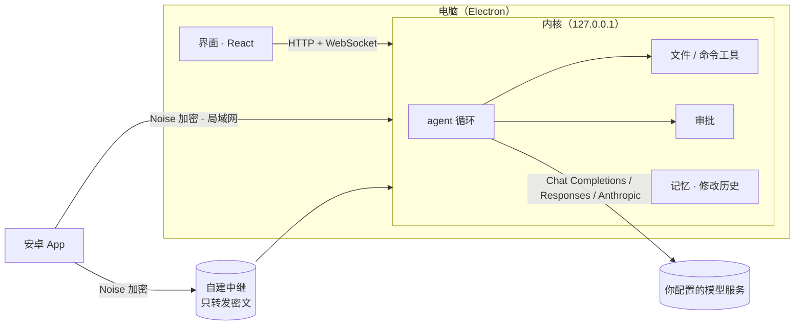

<div align="center">

<picture>
  <source media="(prefers-color-scheme: dark)" srcset="docs/brand/horizontal/minibot-horizontal-white-1200.png">
  
</picture>

# minibot

**一个完全由你掌控的桌面 AI 助理：自带 agent 内核，在你的电脑上动手干活，危险操作先问你。**

[下载](https://github.com/JiaMingWang-CN/minibot/releases/latest) &nbsp;·&nbsp; [发版说明](docs/release.md) &nbsp;·&nbsp; [设计文档](docs/specs)

<sub>不需要注册账号，不依赖任何云服务——除了你自己配置的模型 API。对话、记忆和密钥都留在你的电脑上。</sub>


[](https://github.com/JiaMingWang-CN/minibot/releases/latest)

<br>

<a href="https://github.com/JiaMingWang-CN/minibot/releases/latest">
  
</a>
&nbsp;
<a href="https://github.com/JiaMingWang-CN/minibot/releases/latest">
  
</a>

<sub>[最新版本](https://github.com/JiaMingWang-CN/minibot/releases/latest) &nbsp;·&nbsp; Windows：x64 安装包 &nbsp;·&nbsp; Android：直接安装的 APK（不上架） &nbsp;·&nbsp; [全部版本](https://github.com/JiaMingWang-CN/minibot/releases)</sub>

</div>

---

## 为什么做

想要一个像 Grok Bot、OpenMausBot 那样的“有人设、能动手”的 AI 助理，但现有方案大多绑定了某个账号、云电脑或付费套餐。minibot 是它的最小底座，重新做成完全自持的形态：

- **自带 agent 内核。** 不调用任何外部 agent CLI。内核自己接入三种模型 API 格式（OpenAI Chat Completions、OpenAI Responses、Anthropic Messages），填上服务地址和 API Key 就能用。
- **本地优先。** 内核跑在 Electron 主进程里，只在 `127.0.0.1` 上提供接口；对话、记忆、审批记录都存在 `~/.minibot`，API Key 用系统密钥库加密，不明文落盘。
- **能动手，但先问你。** bot 能在你的电脑上读写文件、搜索、执行命令；每一步危险操作都会变成一张审批卡片，由你决定。

## 功能

<table>
<tr>
<td width="50%" valign="top">

### 🧠 接你自己的模型

内置 DeepSeek、火山 Coding Plan / Agent Plan 等预设，也可以按三种 API 格式接任意兼容服务。每个服务下可以自己维护模型：上下文长度、输出上限、是否支持图片、支持哪些思考档位。

</td>
<td width="50%" valign="top">

### 🙋 危险操作先问你

审批有三档：逐项批准、自动接受工作区内的编辑、全部放行（敏感路径始终会问）。审批时可以勾选“总是允许这条命令”，加进命令白名单。每一次决定都记在审批记录里。

</td>
</tr>
<tr>
<td width="50%" valign="top">

### 🛠️ 在你的电脑上干活

六个工具：读文件、写文件、改文件、按通配符找文件、按内容搜索、执行命令。路径会做校验，工作区外的读取和所有写入、命令都按审批档位处理。

</td>
<td width="50%" valign="top">

### 📝 有据可查的长期记忆

bot 会把值得记住的内容整理进记忆文件；后台用你指定的模型整理。每一次修改都有历史，可以查看、可以撤销，也可以直接打开记忆目录手动编辑。

</td>
</tr>
<tr>
<td width="50%" valign="top">

### 📱 手机上继续聊

安卓 App 扫码配对电脑后，经局域网直连或你自己部署的中继连接：选对话、聊天（可发图片）、中断回复、处理审批，App 不在前台也能收到审批和完成通知。全程端到端加密，中继看不到内容。

</td>
<td width="50%" valign="top">

### 🔄 应用内更新与反馈

两端都会从 GitHub Releases 检查新版本：电脑端后台下载、提示重启更新；手机端下载并校验后调起系统安装。设置里可以直接提交问题反馈，可选附带最近日志，提交前能预览。

</td>
</tr>
</table>

**还有：** 多个对话线程，可重命名、删除 · 流式回复与思考过程 · 按模型选择思考强度 · 上下文快满时压缩成摘要 · 每条消息最多 4 张图片 · 黑白灰界面，自动跟随浅色 / 深色。

## 技术栈

<div align="center">


</div>

| 组件 | 用途 |
|---|---|
| **Electron + Node 24** | 桌面端外壳；主进程承载内核与本机 HTTP / WebSocket 接口 |
| **React 19 + Vite + Tailwind v4** | 桌面与手机共用的界面 |
| **node:sqlite** | 对话、审批记录、诊断队列的本地存储，无需原生编译 |
| **Capacitor + Kotlin** | 安卓 App；加密连接、通知与更新在原生层 |
| **Noise 协议（XXpsk3 / KK）** | 手机与电脑之间的端到端加密，局域网与中继共用 |

## 工作原理

界面只通过内核的本机接口通信，审批逻辑只在内核里有一处；手机是另一个前端，活仍然由电脑上的内核执行。



| 层 | 位置 | 做什么 |
|---|---|---|
| 内核 | `packages/core/` | bot、agent 循环、三种模型适配器、工具、审批、记忆、存储、本机接口、远程网关、诊断日志 |
| 桌面端 | `apps/desktop/` | Electron 主进程：启动内核、系统密钥库、托盘、崩溃捕获、应用内更新 |
| 界面 | `apps/renderer/` | 开机动画、初始化流程、主界面；文案集中在 `src/i18n.ts` |
| 手机端 | `apps/mobile/` | Capacitor 安卓 App，界面复用 `apps/renderer` 的组件；详见 [apps/mobile/README.md](apps/mobile/README.md) |
| 中继 | `packages/relay/` | 按路由号把手机和电脑接起来，只转发密文；可选开启诊断收集；部署见 [packages/relay/README.md](packages/relay/README.md) |

## 快速开始

**安装包（[最新版本](https://github.com/JiaMingWang-CN/minibot/releases/latest)）：**

| | 下载 | 安装 |
|---|---|---|
| **Windows**（x64） | `minibot-setup-X.Y.Z.exe` | 运行安装程序，可选安装目录。安装包没有代码签名，SmartScreen 会提示“未知发布者”：**更多信息 → 仍要运行**。 |
| **Android**（8.0+） | `minibot-X.Y.Z.apk` | 在手机上打开，按提示允许“安装未知应用”。之后的更新在 App 内完成。 |

首次启动按初始化流程填写模型服务与 API Key、给主 bot 起名、选择工作目录。要用手机，在电脑端 **设置 → 手机** 里填中继地址（可选），点“配对新手机”，用 App 扫码。

**从源码运行：**

```sh
git clone https://github.com/JiaMingWang-CN/minibot && cd minibot
npm install
npm run build
npm start          # 启动桌面端
```

要求：**Node 24+**、Windows（桌面端）。用 `MINIBOT_HOME` 指向一个临时目录，可以从初始化流程开始体验，不动真实数据。

```sh
npm run lint       # ESLint
npm test           # 内核与中继的测试
npm run pack       # 构建并打 Windows 安装包 → apps/desktop/release/
```

安卓端的环境、签名与出包见 [apps/mobile/README.md](apps/mobile/README.md)；发版流程见 [docs/release.md](docs/release.md)。

## 状态

第一阶段可用：单个主 bot 的完整闭环——初始化、三种模型格式、文件与命令工具、审批、多线程、记忆，加上安卓远程、诊断反馈和应用内更新。目前只有 Windows 桌面安装包。

还没有的：多个 bot 与 bot 之间的委托、群聊；skill、MCP、定时任务；浏览器自动化；iOS 与 macOS / Linux 安装包。

## 隐私

诊断信息可以随时关闭：初始化时、电脑端 **设置 → 关于**、手机端设置里都有开关。打开时只发送错误类型、崩溃堆栈（已去掉路径和用户名）、耗时、次数与版本号，到作者的服务器；**从不发送**对话内容、bot 人设、记忆、文件内容、图片、API Key、中继口令与配对密钥。反馈只在你主动提交时发送，附带日志前可以预览。自己从源码构建的版本默认不会上传任何东西。

## 许可证

[Apache License 2.0](LICENSE) © 2026 JiaMingWang-CN 与 minibot 贡献者。可以自由使用、修改和商用，分发时保留 [LICENSE](LICENSE) 与 [NOTICE](NOTICE)。

许可证不包含商标授权：fork 或改版后发布，请换用自己的名称与图标，不要以 minibot 的名义发布。
